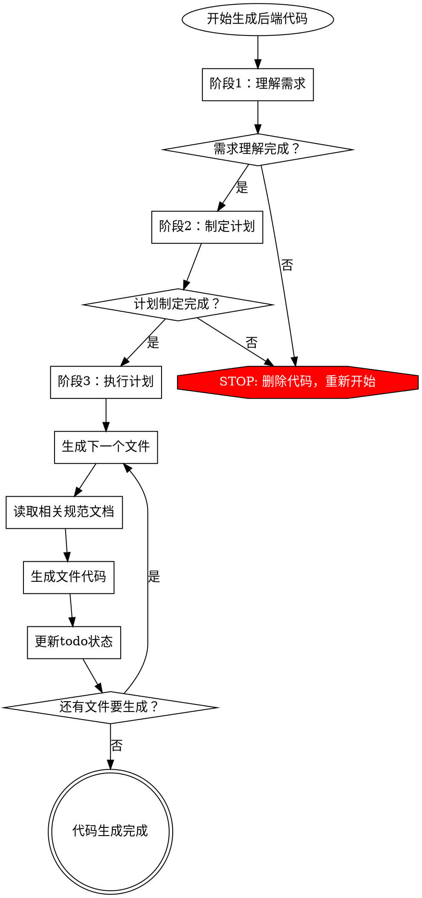

# 后端代码生成器

生成严格遵循项目编码标准和架构模式的后端代码。**必须遵循三阶段流程：理解需求 → 制定计划 → 执行计划（每步检查规范）**。

## 核心原则

**违反流程就是违反规范。** 不允许跳过任何阶段，不允许在执行前不检查规范。

## 三阶段强制流程

生成任何后端代码前，**必须严格遵循**以下三个阶段：

### 阶段1：理解需求（必须完成）

**目标：** 全面理解用户需求，识别所有涉及的组件和规范。

**必须完成的任务：**
- [ ] 明确要生成的功能模块和业务场景
- [ ] 识别涉及的数据库表（查看 `_sdd/database/README.md` 和对应的DDL文件）
- [ ] 识别涉及的代码层次（Controller、Service、Mapper、DTO、Entity等）
- [ ] 识别需要的功能特性（分页、异常处理、Excel导入导出等）
- [ ] 识别可能使用的公共组件（工具类、技术组件、公共接口）
- [ ] **使用 `todo_write` 工具创建任务清单**，记录所有识别出的组件

**禁止行为：**
- ❌ 跳过需求理解直接开始编码
- ❌ 假设字段名或数据类型（必须查看数据库表结构）
- ❌ 忽略可能使用的公共组件

### 阶段2：制定生成计划（必须完成）

**目标：** 制定详细的代码生成计划，明确每个步骤需要参考的规范文档。

**必须完成的任务：**
- [ ] 列出需要生成的所有文件（Controller、Service、Mapper、DTO、Entity等）
- [ ] 为每个文件列出需要参考的规范文档清单
- [ ] 明确生成顺序（建议：Entity → DTO → Mapper → Service → Controller）
- [ ] 识别每个步骤的依赖关系
- [ ] **使用 `todo_write` 工具创建执行计划**，每个步骤作为独立任务

**规范文档位置：** `_sdd/spec/04_后端代码规范/`

**核心规范（始终优先阅读）：**
1. `分层结构.md` - 分层架构原则
2. `后端项目结构.md` - 项目组织方式
3. `后端模块命名规则.md` - 命名约定
4. `全局规范.md` - 全局规范
5. `odin-platform/odin-web/src/main/java/com/insigma/business/demo` - 案例代码

**分层规范（按需阅读）：**
- Controller层：`Controller层规范.md`
- Service层：`Service 层规范.md`
- 持久层：`持久层操作API.md`
- 数据结构：`数据结构规范.md`

**功能规范（按需阅读）：**
- 分页：`分页操作规范.md`
- 异常处理：`异常处理规范.md`
- API响应：`ResponseMessage.md`

**公共组件（使用前必读）：**

**公共工具类规范文档（位于 `_sdd/spec/04_后端代码规范/公共工具/`）：**
- `公共工具/DTO与Entity转换工具类(DtoEntityUtil).md` - 规定DTO与Entity转换工具的使用方法
- `公共工具/HTTP URL工具类(HttpUrlUtil).md` - 规定HTTP URL工具类的使用方法
- `公共工具/请求包装工具类(OdinHttpRequestWrapper).md` - 规定请求包装工具的使用方法
- `公共工具/身份证处理工具类(IdCardUtil).md` - 规定身份证处理工具的使用方法
- `公共工具/树形数据处理工具类(TreeUtil).md` - 规定树形数据处理工具的使用方法
- `公共工具/数据库操作工具类(DBUtil).md` - 规定数据库操作工具的使用方法
- `公共工具/字符串压缩工具类(StringCompress).md` - 规定字符串压缩工具的使用方法
- `公共工具/ID生成工具类(IDUtil).md` - 规定ID生成工具的使用方法
- `公共工具/IP获取工具类(IpUtil).md` - 规定IP获取工具的使用方法
- `公共工具/SM2国密算法工具类(SM2Utils).md` - 规定SM2国密算法工具的使用方法
- `公共工具/SM3国密算法工具类(SM3Utils).md` - 规定SM3国密算法工具的使用方法
- `公共工具/SM4国密算法工具类(SM4Utils).md` - 规定SM4国密算法工具的使用方法
- `公共工具/Spring上下文工具类(SpringContextUtil).md` - 规定Spring上下文工具的使用方法
- `公共工具/获取当前登录用户服务(CurrentUserService).md` - 规定获取当前登录用户服务的使用方法

**公共技术组件规范文档（位于 `_sdd/spec/04_后端代码规范/公共技术组件/`）：**
- `公共技术组件/Excel导入导出组件规范.md` - 规定Excel导入导出组件的使用标准
- `公共技术组件/分布式任务调度组件规范.md` - 规定分布式任务调度组件的使用标准
- `公共技术组件/文件存储服务组件规范.md` - 规定文件存储服务组件的使用标准（**涉及到文件上传下载时必须参考该规范**）

**公共接口规范文档（位于 `_sdd/spec/04_后端代码规范/公共接口/`）：**
- `公共接口/字典查询接口.md` - 提供字典查询和初始化的接口
- `公共接口/用户菜单权限查询接口.md` - 提供获取当前用户权限下的菜单和按钮级权限列表的接口

**禁止行为：**
- ❌ 不制定计划直接开始生成代码
- ❌ 计划中不包含规范文档清单
- ❌ 忽略案例代码参考

### 阶段3：执行计划（每步检查规范）

**目标：** 严格按照计划执行，每生成一个文件前必须检查相关规范。

**执行规则：**
- [ ] **每生成一个文件前，必须使用 `read_file` 读取相关规范文档**
- [ ] 生成Entity前：读取数据库DDL文件、`数据结构规范.md`、`后端模块命名规则.md`
- [ ] 生成DTO前：读取`数据结构规范.md`、`后端模块命名规则.md`、Entity文件（如已生成）
- [ ] 生成Mapper前：读取`持久层操作API.md`、`后端模块命名规则.md`、Entity文件
- [ ] 生成Service前：读取`Service 层规范.md`、`异常处理规范.md`、`后端模块命名规则.md`、Mapper文件
- [ ] 生成Controller前：读取`Controller层规范.md`、`ResponseMessage.md`、`分页操作规范.md`（如需要）、`后端模块命名规则.md`、Service文件
- [ ] 使用公共组件前：读取对应的组件规范文档
- [ ] **每完成一个文件，更新todo状态为completed**

**禁止行为：**
- ❌ 不读取规范文档就生成代码
- ❌ 假设规范内容而不实际读取
- ❌ 跳过某个文件的规范检查
- ❌ 不更新todo状态

## 规范文档查找规则

### 数据库表结构
1. 查看 `_sdd/database/README.md` 找到相关表名
2. 读取 `_sdd/database/ddls/{表名}.sql` 了解表结构
3. 字段名、数据类型必须与数据库表结构完全一致

### 代码规范文档
1. 所有规范位于 `_sdd/spec/04_后端代码规范/`
2. 使用 `read_file` 工具读取，不要猜测规范内容
3. 阅读完整文档，不要只看摘要

### 案例代码
1. 参考 `odin-platform/odin-web/src/main/java/com/insigma/business/demo/demo1/`
2. 理解代码结构和模式
3. 保持与案例代码的一致性

## 常见Rationalization及应对

| 借口 | 现实 |
|------|------|
| "我熟悉规范，不需要再读" | 规范可能更新，必须读取最新版本 |
| "先写代码，有问题再改" | 违反流程就是违反规范，必须删除重来 |
| "这个很简单，跳过计划" | 简单功能也需要完整流程，确保一致性 |
| "规范文档太长，只看摘要" | 必须阅读完整文档，摘要可能遗漏关键信息 |
| "先写一个文件试试" | 必须完成阶段1和阶段2，才能进入阶段3 |
| "我参考了其他代码，不需要读规范" | 其他代码可能不符合最新规范，必须读规范文档 |

## Red Flags - 立即停止并重新开始

如果出现以下情况，**必须停止当前工作，删除已生成的代码，重新从阶段1开始**：

- 开始生成代码前没有完成阶段1（理解需求）
- 开始生成代码前没有完成阶段2（制定计划）
- 生成某个文件前没有读取相关规范文档
- 假设了字段名或数据类型而没有查看数据库表结构
- 跳过了todo清单中的某个步骤

**所有这些都是流程违规，必须重新开始。**

## 执行检查清单

生成后端代码时，必须完成以下所有项目：

**阶段1：理解需求**
- [ ] 使用 `codebase_search` 或 `read_file` 查找数据库表结构
- [ ] 识别所有涉及的代码层次
- [ ] 识别所有需要的功能特性
- [ ] 识别所有可能使用的公共组件
- [ ] 使用 `todo_write` 创建任务清单

**阶段2：制定计划**
- [ ] 列出所有需要生成的文件
- [ ] 为每个文件列出规范文档清单
- [ ] 明确生成顺序
- [ ] 使用 `todo_write` 创建执行计划

**阶段3：执行计划**
- [ ] 生成Entity前读取：数据库DDL、`数据结构规范.md`、`后端模块命名规则.md`
- [ ] 生成DTO前读取：`数据结构规范.md`、`后端模块命名规则.md`、Entity文件
- [ ] 生成Mapper前读取：`持久层操作API.md`、`后端模块命名规则.md`、Entity文件
- [ ] 生成Service前读取：`Service 层规范.md`、`异常处理规范.md`、`后端模块命名规则.md`、Mapper文件
- [ ] 生成Controller前读取：`Controller层规范.md`、`ResponseMessage.md`、`分页操作规范.md`（如需要）、`后端模块命名规则.md`、Service文件
- [ ] 使用公共组件前读取对应规范文档
- [ ] 每完成一个文件更新todo状态

## 适用范围

此技能适用于：
- `odin-platform/**/*` 下的所有文件
- 项目中的所有 `**/*.java` 文件

## 注意事项

- **自动发现**：必须主动使用工具查找数据库表结构和规范文档
- **完整参考**：必须阅读完整的规范文档，不能只参考部分内容
- **一致性**：生成的代码必须与现有项目代码和规范保持一致
- **中文注释**：代码注释使用中文，清晰说明业务逻辑
- **禁止硬编码**：遵循`全局规范.md`，使用常量或枚举替换硬编码
