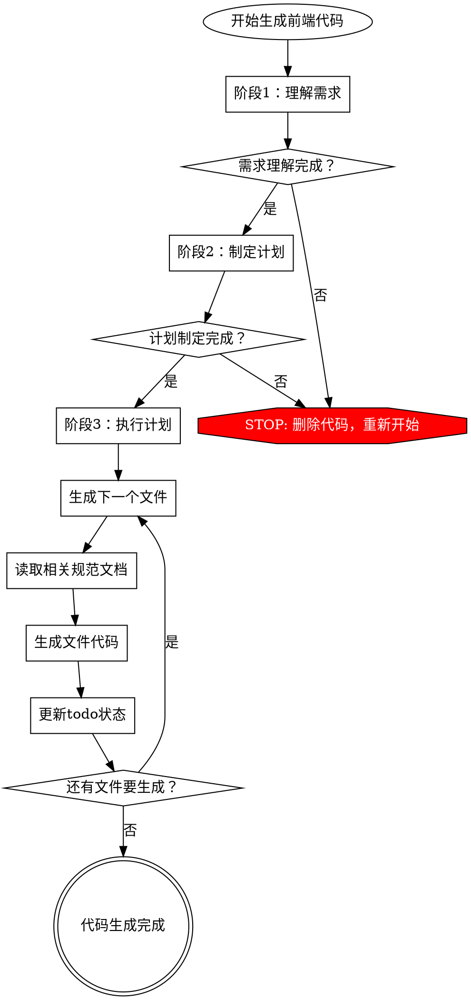

# 前端代码生成器

生成严格遵循项目技术栈、编码标准和架构模式的前端代码。**必须遵循三阶段流程：理解需求 → 制定计划 → 执行计划（每步检查规范）**。

## 核心原则

**违反流程就是违反规范。** 不允许跳过任何阶段，不允许在执行前不检查规范。

## 三阶段强制流程

生成任何前端代码前，**必须严格遵循**以下三个阶段：

### 阶段1：理解需求（必须完成）

**目标：** 全面理解用户需求，识别所有涉及的文件类型和规范。

**必须完成的任务：**
- [ ] 明确要生成的功能模块和业务场景
- [ ] 识别涉及的文件类型（Vue组件、TypeScript模块、API调用、路由配置等）
- [ ] 识别涉及的数据库表（如需要，查看 `_sdd/database/README.md` 和对应的DDL文件）
- [ ] 识别需要的功能特性（API调用、路由配置、字典数据、公共组件使用等）
- [ ] 识别可能使用的公共组件（查看 `_sdd/spec/03_前端代码规范/组件使用规范/`）
- [ ] 识别可能使用的公共函数（查看 `_sdd/spec/03_前端代码规范/公共函数调用方法.md`）
- [ ] **使用 `todo_write` 工具创建任务清单**，记录所有识别出的组件和文件

**禁止行为：**
- ❌ 跳过需求理解直接开始编码
- ❌ 假设字段名或数据类型（必须查看数据库表结构，如涉及）
- ❌ 忽略可能使用的公共组件和函数
- ❌ 不识别文件类型就生成代码

### 阶段2：制定生成计划（必须完成）

**目标：** 制定详细的代码生成计划，明确每个步骤需要参考的规范文档。

**必须完成的任务：**
- [ ] 列出需要生成的所有文件（Vue组件、TypeScript模块、API文件、路由配置等）
- [ ] 为每个文件列出需要参考的规范文档清单
- [ ] 明确生成顺序（建议：API文件 → 路由配置 → Vue组件）
- [ ] 识别每个步骤的依赖关系
- [ ] **使用 `todo_write` 工具创建执行计划**，每个步骤作为独立任务

**规范文档位置：** `_sdd/spec/03_前端代码规范/`

**核心规范（始终优先阅读）：**
1. `技术栈.md` - 项目使用的技术栈和框架版本
2. `工程目录结构.md` - 项目文件组织方式
3. `文件命名规范.md` - 文件命名标准
4. `文件存放规范.md` - 文件存放位置规则

**功能开发规范（按需阅读）：**
- API接口调用：`接口调用规范.md` - 调用后端接口、处理HTTP请求时
- 路由配置：`功能路由.md` - 添加新页面、配置路由时
- 公共函数：`公共函数调用方法.md` - 使用或创建工具函数时
- 样式编写：`公共样式规范.md` - 编写CSS/SCSS样式时
- 字典数据：`字典使用规范.md` - 使用数据字典、下拉选项时

**组件使用规范（使用前必读）：**
- 组件目录：`组件使用规范/`
  - 表格穿梭框：`TableTransfer.md`
  - 标题组件：`Title.md`
  - 其他组件参考对应规范文件

**禁止行为：**
- ❌ 不制定计划直接开始生成代码
- ❌ 计划中不包含规范文档清单
- ❌ 忽略核心规范文档

### 阶段3：执行计划（每步检查规范）

**目标：** 严格按照计划执行，每生成一个文件前必须检查相关规范。

**执行规则：**
- [ ] **每生成一个文件前，必须使用 `read_file` 读取相关规范文档**
- [ ] 生成API文件前：读取`接口调用规范.md`、`文件命名规范.md`、`文件存放规范.md`
- [ ] 生成路由配置前：读取`功能路由.md`、`文件命名规范.md`、`文件存放规范.md`
- [ ] 生成Vue组件前：读取`技术栈.md`、`文件命名规范.md`、`文件存放规范.md`、`公共样式规范.md`（如需要）
- [ ] 使用字典数据前：读取`字典使用规范.md`
- [ ] 使用公共组件前：读取对应的组件规范文档（如 `组件使用规范/TableTransfer.md`）
- [ ] 使用公共函数前：读取`公共函数调用方法.md`
- [ ] 涉及数据库表字段时：读取对应的DDL文件（`_sdd/database/ddls/{表名}.sql`）
- [ ] **每完成一个文件，更新todo状态为completed**

**禁止行为：**
- ❌ 不读取规范文档就生成代码
- ❌ 假设规范内容而不实际读取
- ❌ 跳过某个文件的规范检查
- ❌ 不更新todo状态
- ❌ 使用公共组件前不读取组件规范

## 规范文档查找规则

### 数据库表结构（如涉及）
1. 查看 `_sdd/database/README.md` 找到相关表名
2. 读取 `_sdd/database/ddls/{表名}.sql` 了解表结构
3. 字段名、数据类型必须与数据库表结构完全一致（用于表单字段映射）

### 代码规范文档
1. 所有规范位于 `_sdd/spec/03_前端代码规范/`
2. 使用 `read_file` 工具读取，不要猜测规范内容
3. 阅读完整文档，不要只看摘要

### 现有代码参考
1. 参考 `odin-web-ui-plus/src/` 下的现有代码
2. 理解代码结构和模式
3. 保持与现有代码的一致性

## 常见Rationalization及应对

| 借口 | 现实 |
|------|------|
| "我熟悉规范，不需要再读" | 规范可能更新，必须读取最新版本 |
| "先写代码，有问题再改" | 违反流程就是违反规范，必须删除重来 |
| "这个很简单，跳过计划" | 简单功能也需要完整流程，确保一致性 |
| "规范文档太长，只看摘要" | 必须阅读完整文档，摘要可能遗漏关键信息 |
| "先写一个文件试试" | 必须完成阶段1和阶段2，才能进入阶段3 |
| "我参考了其他代码，不需要读规范" | 其他代码可能不符合最新规范，必须读规范文档 |
| "Vue组件不需要数据库表结构" | 如果涉及表单字段映射，必须查看数据库表结构 |

## Red Flags - 立即停止并重新开始

如果出现以下情况，**必须停止当前工作，删除已生成的代码，重新从阶段1开始**：

- 开始生成代码前没有完成阶段1（理解需求）
- 开始生成代码前没有完成阶段2（制定计划）
- 生成某个文件前没有读取相关规范文档
- 假设了字段名或数据类型而没有查看数据库表结构（如涉及）
- 跳过了todo清单中的某个步骤
- 使用公共组件前没有读取组件规范文档

**所有这些都是流程违规，必须重新开始。**

## 执行检查清单

生成前端代码时，必须完成以下所有项目：

**阶段1：理解需求**
- [ ] 使用 `codebase_search` 或 `read_file` 查找数据库表结构（如涉及）
- [ ] 识别所有涉及的文件类型
- [ ] 识别所有需要的功能特性
- [ ] 识别所有可能使用的公共组件和函数
- [ ] 使用 `todo_write` 创建任务清单

**阶段2：制定计划**
- [ ] 列出所有需要生成的文件
- [ ] 为每个文件列出规范文档清单
- [ ] 明确生成顺序
- [ ] 使用 `todo_write` 创建执行计划

**阶段3：执行计划**
- [ ] 生成API文件前读取：`接口调用规范.md`、`文件命名规范.md`、`文件存放规范.md`
- [ ] 生成路由配置前读取：`功能路由.md`、`文件命名规范.md`、`文件存放规范.md`
- [ ] 生成Vue组件前读取：`技术栈.md`、`文件命名规范.md`、`文件存放规范.md`、`公共样式规范.md`（如需要）
- [ ] 使用字典数据前读取：`字典使用规范.md`
- [ ] 使用公共组件前读取对应组件规范文档
- [ ] 使用公共函数前读取：`公共函数调用方法.md`
- [ ] 涉及数据库表字段时读取对应的DDL文件
- [ ] 每完成一个文件更新todo状态

## 适用范围

此技能适用于：
- `odin-web-ui-plus/**/*` 下的所有文件
- 项目中的所有 `**/*.vue` 文件
- 项目中的所有 `**/*.ts` 和 `**/*.js` 文件

## 注意事项

- **自动发现**：必须主动使用工具查找数据库表结构和规范文档
- **完整参考**：必须阅读完整的规范文档，不能只参考部分内容
- **一致性**：生成的代码必须与现有项目代码和规范保持一致
- **中文注释**：代码注释使用中文，清晰说明业务逻辑
- **技术栈遵循**：严格使用项目指定的框架和库版本（Vue 3、TypeScript、Element Plus等）
- **组件复用**：优先使用项目提供的公共组件和函数，避免重复造轮子
